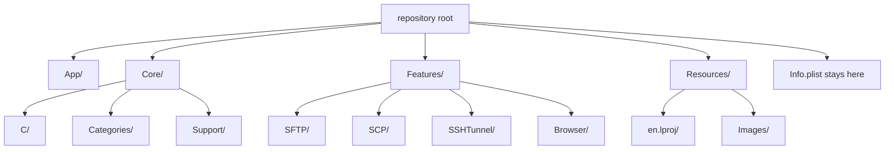

# Architecture Decision: Step 1 on-disk layout

📌 CREATIVE PHASE START: Project layout
━━━━━━━━━━━━━━━━━━━━━━━━━━━━━━━

## 1. Problem

Xcode groups are virtual. Every source file sits in the repository root, and `PBXFileReference` paths are filenames. The migration wants real folders (`App`, `Core`, `Features`, `Resources`) without changing behavior or `#import "Header.h"` lines.

Requirements:

- One move, then a Mac build of the same target.
- Quoted imports stay as they are.
- XIB outlets and actions stay wired. Class names do not change in Step 1.
- `Info.plist` path stays `Info.plist`.

Constraints: header maps, a Headers build phase that already lists every project header, and filenames that contain parentheses.

## 2. Options

- Option A: Virtual groups only. No files move.
- Option B: Move files, set `PBXGroup.path`, leave each file reference as a filename, rely on the target header map.
- Option C: Move files and rewrite every `#import` to a relative path.

## 3. Analysis

| Criterion | A virtual | B group path | C rewrite imports |
| --- | --- | --- | --- |
| Behavior risk | Lowest | Low if the header map holds | Low, huge diff |
| Meets the layout goal | No | Yes | Yes |
| Review cost | None | `pbxproj` plus `git mv` | Every source file |
| Rollback | Trivial | One commit | Painful |

XIB custom classes store class names, not paths. Moving a `.m` does not touch a XIB until the class's module changes, which is a later step.

## 4. Decision

Selected: Option B.

Rationale: The layout request is real, and the header map already knows these headers because they are in the target. Rewriting imports adds noise without making the build safer.

## 5. Implementation notes

- Folders: `App/`, `Core/C/`, `Core/Categories/`, `Core/Support/`, `Features/SFTP/`, `Features/SCP/`, `Features/SSHTunnel/`, `Features/Browser/`, `Resources/`, `Resources/Images/`, `Resources/en.lproj/`.
- Leave `Info.plist` at the repository root. Do not change `INFOPLIST_FILE`.
- Set `path` on each group. Do not put directory prefixes on `PBXFileReference.path`.
- Variant groups (`MainMenu.xib` and the other XIBs) stay named as they are. The `en` child stays a localization. After the move, Xcode must resolve `Resources/en.lproj/<Name>.xib`.
- Image references stay filenames under a group whose path is `Resources/Images`.
- Do not set `USER_HEADER_SEARCH_PATHS` on the first attempt. If the Mac build reports a missing header, add `$(SRCROOT)` recursively and stop. Do not "fix" it by editing imports in the same commit.
- Keep every file in its current build phase (Sources, Headers, Resources).
- Do this on the Mac, on `migrate/step-01-project-structure-and-bridging`, after the baseline `xcodebuild` succeeds.

Validation: Mac build exits 0, the app launches, and no import line changed.

━━━━━━━━━━━━━━━━━━━━━━━━━━━━━━━
📌 CREATIVE PHASE END
