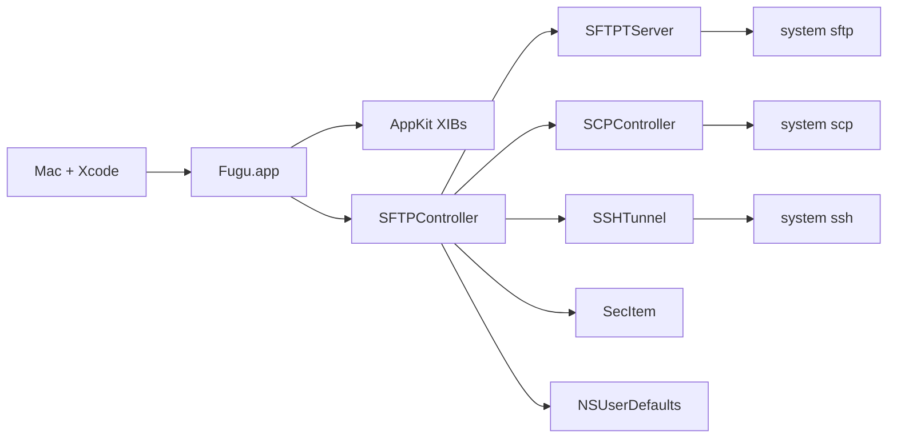

# Task: Fugu Objective-C to Swift migration

## Description

Move Fugu from a flat Objective-C/C AppKit app to idiomatic Swift in a feature-based layout, without changing behavior. Each step compiles on its own. Development and every build stay on the local Mac that has Xcode. This Linux workspace is for planning only.

## Complexity

Level: 4
Type: Complex System

## Development host

The Mac with Xcode is the only development machine.

- Edit, branch, build, run, and smoke-test in the Mac checkout.
- Do not compile or run Fugu from the Linux cloud agent. `xcodebuild` is not installed there, and a Linux build would not prove the Mac app.
- Branch names on the Mac follow the migration spec: `migrate/step-<NN>-<short-description>`.
- The shared scheme is user-local today (`Fugu.xcodeproj/xcuserdata/.../Fugu.xcscheme`, gitignored). A stale user scheme named `externaleditor` points at a target that is no longer in the project. Ignore it.

Mac baseline, before any migration branch:

```bash
cd /path/to/fugu
xcodebuild -project Fugu.xcodeproj -scheme Fugu -configuration Development build
```

If Xcode says the scheme is missing, open the project, choose Product → Scheme → Manage Schemes, and mark Fugu shared. Commit that shared scheme from the Mac. Then run the app from Xcode and confirm the dual-pane window opens.

## Technology Stack

- Framework: AppKit (Cocoa). Not UIKit. Not SwiftUI in the foundation steps.
- Build tool: Xcode on the Mac. Project file `Fugu.xcodeproj`. Configurations Development, Deployment, Default.
- Language: Objective-C and C remain until each file is migrated. Swift 6 is already set (`SWIFT_VERSION = 6.0`) and unused.
- Deployment: macOS 11.5. Leave it.
- Storage: `NSUserDefaults`, login keychain via `SecItem`, remote state in OpenSSH subprocesses.
- Packages: none. No CocoaPods, Carthage, or Swift package is linked. Do not add one in Steps 1–3.

## Technology Validation Checkpoints

- [x] Stack defined from the existing project (AppKit, Swift 6 setting, ARC already on)
- [x] Mac build command documented above
- [x] Dependencies identified: Cocoa, Security, CoreServices, CoreFoundation, system `ssh` / `sftp` / `scp`
- [ ] Baseline `xcodebuild` run on the Mac (required before Step 1 edits)
- [ ] Step 1 Swift smoke file added and built on the Mac
- [ ] Test build passes on the Mac after each migration branch

The unchecked items are Mac work. `/build` was started on 5 Nov 2026 and stopped at this gate. Step 1 files were not moved.

## Build log

Command, from `/workspace` on the cloud agent:

```text
uname -s
→ Linux

command -v xcodebuild
→ absent

command -v xcode-select
→ absent
```

The baseline `xcodebuild -project Fugu.xcodeproj -scheme Fugu -configuration Development build` was not run. This machine cannot compile a macOS target, and the plan says a Linux result would not count. No `migrate/step-01-project-structure-and-bridging` branch was created. No Swift file, bridging header, folder move, or nullability edit was applied.

Step 1 stays blocked until that command exits 0 on the Mac and the dual-pane window opens. Steps 2–6 stay blocked behind Step 1.

## Status

- [x] Initialization complete (VAN)
- [x] Planning complete
- [x] Creative decisions (`/creative`)
- [ ] Technology build gate on the Mac
- [ ] Step 1 implementation
- [ ] Steps 2–6
- [ ] Reflection and archive

## Architecture

One application target, `Fugu` (`edu.umich.fugu`). `NSApplicationMain` loads `MainMenu.xib`. `SFTPController` is the app delegate. Transfers call system OpenSSH in-process. Listings are dictionaries. UI is four English XIBs plus AppKit subclasses.



Selected shape for the migration:

- Stay one AppKit target. Add Swift beside Objective-C with a bridging header and `Fugu-Swift.h`.
- Keep system OpenSSH as the protocol engine unless a later creative decision says otherwise.
- Introduce typed models only when Objective-C callers can still see them.
- Reorganize disks folders to match real features. Do not invent empty ViewModel or Models trees.
- Verify every branch on the Mac before the next branch.

### Subsystems

| Subsystem | Files | Migrates in |
| --- | --- | --- |
| Project and interop | `project.pbxproj`, headers, new Swift probe | Step 1 |
| Leaf utilities | Categories, `keychain.c`, `UMVersionCheck`, `UMFileLauncher` | Steps 2–3 |
| Listings and constants | `#define`s, dictionary rows | Step 3 |
| Transfer engine | `SFTPTServer`, `SCPTransfer`, `SSHTunnelAuth`, C spawn helpers | Step 4 |
| Screens | `SFTPController`, prefs, SCP window, tunnel window, browser subclasses, XIBs | Step 5 |
| Lifecycle | `main.m`, bridging cleanup | Step 6 |

### Integration points that must keep working

- XIB outlets and actions on `SFTPController`, `SFTPPrefs`, `SCPController`, `SSHTunnel`.
- Services menu message `secureCopyFile`.
- Keychain items already stored with `SecItem`.
- Temp directory `/private/tmp/Fugu`.
- ODB editor Apple Events (`aevent.c`, `ODBEditorSuite.h`).
- Version plist at `VERSION_URL` in `UMVersionCheck.h`.
- Gestalt-packed OS version from `NSWorkspace(SystemVersionNumber)` until callers change.

## Implementation Plan

Each step is its own branch, created on the Mac, and merged only after that Mac build and smoke test pass.

### 1. `migrate/step-01-project-structure-and-bridging`

Impact: configuration. No behavior change.

- [ ] Run the Mac baseline build and launch Fugu once.
- [ ] Create the branch on the Mac.
- [ ] Move sources into `App/`, `Core/C/`, `Core/Categories/`, `Core/Support/`, `Features/SFTP/`, `Features/SCP/`, `Features/SSHTunnel/`, `Features/Browser/`, `Resources/`.
- [ ] Give each Xcode group a `path`. Leave file-reference paths as filenames. Keep the same compile, header, and resource build phases.
- [ ] Set `PRODUCT_MODULE_NAME = Fugu`, `DEFINES_MODULE = YES`, and `SWIFT_OBJC_BRIDGING_HEADER`.
- [ ] Add an empty bridging header and one Swift file, `FuguSwiftBridge`, to the app target.
- [ ] Add `NS_ASSUME_NONNULL` to Objective-C headers. Mark real optionals `nullable`. Leave C headers on `_Nullable` / `_Nonnull`.
- [ ] Do not change `CC`, `ZERO_LINK`, deployment target, or `SFTPController` logic.
- [ ] Mac: `xcodebuild` Development configuration, then launch, connect, list, upload, download, open SCP, tunnel, and preferences.

### 2. `migrate/step-02-spm-and-native-replacements`

Impact: low. No new package unless `/creative` overrides the default.

- [ ] Replace `NSFileManager(mktemp)` call sites with `FileManager` while keeping `/private/tmp/Fugu`.
- [ ] Wrap `keychain.c` in a small Swift type that still uses `SecItem`. Keep C entry points if Objective-C callers remain.
- [ ] Leave `argcargv`, `fdwrite`, `ee.c`, and `sshversion.c` in C. They belong to the process engine.
- [ ] Mac build and a password-save / password-fill check.

### 3. `migrate/step-03-models-and-constants`

Impact: low-medium.

- [ ] Move toolbar and column `#define`s into Swift enums exposed to Objective-C where the nib or Objective-C still reads them.
- [ ] Add a remote-entry type for `sftp` listing lines. Keep an `@objc` dictionary bridge while `SFTPController` is Objective-C.
- [ ] Migrate date, icon, encoding, alias, and OS-version categories.
- [ ] Delete a `.h`/`.m` pair only after the Mac build no longer references it.

### 4. `migrate/step-04-services-and-networking`

Impact: medium. Blocked on the process-engine creative decision.

- [ ] Move `SFTPTServer`, `SCPTransfer`, and `SSHTunnelAuth` to Swift.
- [ ] Drive `sftp`, `scp`, and `ssh` with `Process` (or keep the current `fork` path behind a Swift type until parity is proven).
- [ ] Expose completion-handler methods for any Objective-C caller that remains.
- [ ] Move `UMVersionCheck` to `URLSession` and `PropertyListDecoder`.
- [ ] Mac: connect, cancel, resume a listing, upload, download, SCP, and a local forward.

### 5. `migrate/step-05-ui-and-viewcontrollers`

Impact: medium-high. One screen per sub-branch, each built on the Mac.

- [ ] `migrate/step-05a-browser-views` — table, split, scroll, cell, image preview.
- [ ] `migrate/step-05b-preferences` — `SFTPPrefs` and `Prefs.xib`.
- [ ] `migrate/step-05c-scp` — `SCP.xib`.
- [ ] `migrate/step-05d-tunnel` — `SSHTunnel.xib`.
- [ ] `migrate/step-05e-main-window` — `SFTPController` and `MainMenu.xib` last.
- [ ] Update XIB custom-class module names to `Fugu`.
- [ ] Stay on AppKit. Dynamic Type, safe areas, and dark mode are follow-on checks, not a SwiftUI rewrite.

### 6. `migrate/step-06-app-lifecycle-and-cleanup`

Impact: high. Last branch.

- [ ] Replace `main.m` with an `@main` AppKit delegate.
- [ ] Drop `@objc` and `NSObject` from Swift types that XIBs and Objective-C no longer touch.
- [ ] Remove the bridging header when the last `.h`/`.m` is gone.
- [ ] Mac: full smoke pass, then quit and confirm no leftover `sftp`, `scp`, or `ssh` child.

## Creative Phases Required

- [x] Step 1 layout. Decision: move files, set group `path`, keep file-reference filenames and `#import` lines. `Info.plist` stays at the root. See `/workspace/memory-bank/creative/creative-step1-layout.md`.
- [x] Step 1 nullability. Decision: assume nonnull on methods only. `IBOutlet` ivars stay `_Nullable`. See `/workspace/memory-bank/creative/creative-step1-nullability.md`.
- [x] Step 1 probe. Decision: `App/FuguSwiftBridge.swift` in the app target. No XCTest target yet. See `/workspace/memory-bank/creative/creative-step1-swift-probe.md`.
- [x] Listing model. Decision: add `RemoteEntry` with a lossless dictionary bridge. Parser output stays a dictionary until Step 4. See `/workspace/memory-bank/creative/creative-listing-model.md`.
- [x] Process engine. Decision: keep system OpenSSH. Swift wraps the current spawn path. No SSH package. See `/workspace/memory-bank/creative/creative-process-engine.md`.
- [x] Screens. Decision: AppKit only, in the order browser, preferences, SCP, tunnel, main window. No SwiftUI and no visual redesign in the port. See `/workspace/memory-bank/creative/creative-ui-migration.md`.
- [x] `@main`. Decision: Swift `NSApplicationMain` after Steps 1–5. The nib keeps the delegate. Remove the bridging header only when Swift imports no project `.h`. See `/workspace/memory-bank/creative/creative-app-lifecycle.md`.

## Dependencies

- Mac with Xcode, and the system `ssh`, `sftp`, and `scp` binaries.
- Existing Fugu checkout on that Mac. This cloud tree is not the build tree.
- A reachable SSH host for manual transfer checks. No automated test target exists.
- Login keychain access for password round-trip checks.
- Step 4 depends on the process-engine creative decision.
- Step 5 depends on `PRODUCT_MODULE_NAME = Fugu` from Step 1.
- Step 6 depends on Steps 1–5 leaving no Objective-C caller that still needs the bridging header.

## Challenges & Mitigations

- Linux cannot prove a Mac build. Mitigation: no migration edit is "done" until the Mac `xcodebuild` and the smoke list pass. The cloud agent does not substitute a build.
- Moving files breaks the project if group paths and build phases disagree. Mitigation: Step 1 is path-only. Creative phase writes the exact `pbxproj` rules before the move.
- `SFTPController.m` is thousands of lines and nib-coupled. Mitigation: it stays Objective-C until Step 5e, after the smaller screens.
- Nullability can mark outlets nonnull too early. Mitigation: creative phase lists which pointers stay `nullable`.
- No tests. Mitigation: each branch has a written Mac smoke checklist. A test target is optional and not a Step 1 requirement.
- Stale `externaleditor` scheme. Mitigation: do not revive that target. Build the Fugu scheme only.
- `CC = /usr/bin/gcc` and Development `ZERO_LINK = YES` are leftovers. Mitigation: leave them until a dedicated build-settings change, after a clean Mac baseline.

## Requirements trace

Functional behavior that must survive every step: connect, authenticate, list, upload, download, mkdir, delete, rename, preview, edit via ODB, SCP window, Services `secureCopyFile`, SSH tunnel, preferences, keychain passwords, version check.

Non-functional: each branch builds on the Mac; no new third-party package by default; AppKit HIG for any UI work; passwords stay in the keychain; the app stays one process.

## Audit notes carried forward

`audit.md` is stale. The tree has ARC on, deployment target 11.5, no Carthage, and no `NSConnection`. Keychain is already `SecItem`. Alias resolution is already `NSURL`. `aevent.c` still uses `FSRef` / `FSSpec`. Detail from VAN remains valid for file names and roles.
